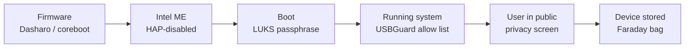

# Layer 1: Physical Security

**Adversaries:** thieves, opportunistic attackers with brief physical access, and visual eavesdroppers ("shoulder surfers").

**Goal:** if my laptop is stolen, lost, or handled by someone else for a few minutes, my data stays confidential and the machine does not quietly accept new hardware.

In cybersecurity we tend to focus almost entirely on remote network attacks. But an adversary with physical access can bypass a surprising number of software defenses. This layer starts from the hardware up: firmware I can inspect, a management engine that is switched off, a disk that is unreadable without my passphrase, USB ports that reject unknown devices, and a screen that only I can read.

The principle behind this layer is **hardware sovereignty**: trust nothing by default and secure the physical endpoint as far as is practical.

## Controls in this layer

| Control | What it does | Status |
| --- | --- | --- |
| [Hardware Selection](./hardware-selection.md) | Open-source (coreboot-based) firmware, Linux-first hardware, camera and microphone physically removed | ✅ Implemented |
| [Intel ME (HAP mode)](./intel-me-hap.md) | Halts the Intel Management Engine early in boot to shrink the firmware attack surface | ✅ Implemented |
| [LUKS Full Disk Encryption](./luks-encryption.md) | Makes the disk unreadable without my passphrase when the machine is powered off | ✅ Implemented |
| [USBGuard](./usbguard.md) | Blocks USB devices that are not on an explicit allow list (BadUSB defense) | ✅ Implemented |
| [Faraday Bag](./faraday-bag.md) | RF isolation for my phone and laptop while they are stored | ✅ Implemented |
| [Privacy Screen](./privacy-screen.md) | Narrows the screen's viewing angle in public spaces | ✅ Implemented |

## How the controls fit together

Each step covers a different moment in the device's life: boot, use, travel, and storage.

## Residual risk for this layer

- **A running or suspended laptop is not "at rest."** LUKS only protects data while the machine is powered off; in suspend the disk key stays in RAM.
- **Evil-maid attacks** (tampering with the boot chain while the device is out of sight) are only partly addressed. See the limitations in [LUKS](./luks-encryption.md#limitations-and-residual-risk).
- **Sophisticated hardware implants and supply-chain interdiction** are out of scope for my [threat model](../THREAT-MODEL.md).

---

[← Stack overview](../README.md) · [Next layer: Operating System →](../02-Operating-System/README.md)
