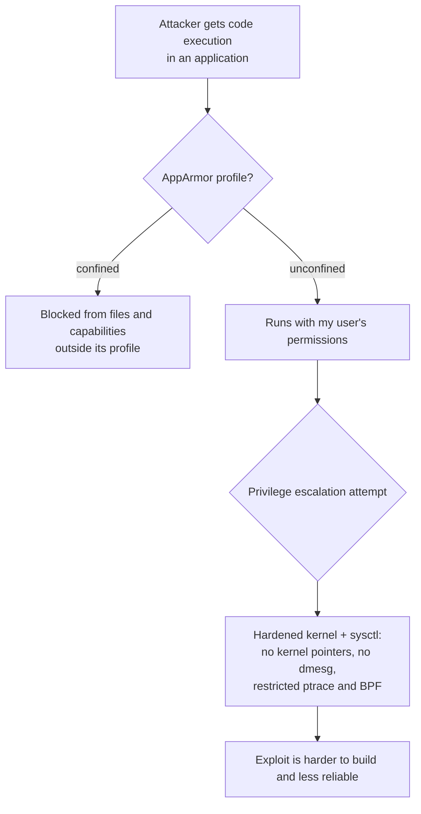

# Layer 2: Operating System

**Adversaries:** malware execution, local privilege escalation, kernel exploits, and system tampering.

**Goal:** a minimal, hardened, and recoverable system, so a compromised application has as little reach as possible and a bad update is never fatal.

The operating system is the foundation everything else runs on. If it is bloated, unpatched, or too trusting by default, every application on top of it is exposed. This layer shrinks the attack surface (install only what I need), hardens the kernel (stricter memory protections and fewer information leaks), confines applications (mandatory access control), and keeps a fast path back to a known-good state (snapshots).

## Controls in this layer

| Control | What it does | Status |
| --- | --- | --- |
| [Arch Linux](./arch-linux.md) | Minimal, rolling-release base: nothing installed that I did not choose | ✅ Implemented |
| [`linux-hardened` kernel](./linux-hardened.md) | Kernel with extra exploit mitigations and stricter defaults | ✅ Implemented |
| [Mandatory Access Control (AppArmor)](./apparmor-selinux.md) | Confines profiled applications to the files and capabilities they need | ✅ Implemented |
| [Sysctl kernel hardening](./sysctl-hardening.md) | Restricts kernel information leaks and cross-process inspection | ✅ Implemented |
| [Btrfs snapshots and recovery](./btrfs-snapshots.md) | Fast rollback after a bad update or user error | ✅ Implemented |

## Defense in depth at the OS layer

## Residual risk for this layer

- **Only profiled applications are confined.** Programs without an AppArmor profile run unconfined (see [MAC](./apparmor-selinux.md#limitations-and-residual-risk)).
- **The AUR is a supply-chain risk.** User-submitted packages are not vetted (see [Arch Linux](./arch-linux.md#limitations-and-residual-risk)).
- **Snapshots are not a recovery plan for a root compromise.** A root-level attacker can delete them (see [Btrfs](./btrfs-snapshots.md#snapshots-and-a-real-compromise)).

---

[← Layer 1: Physical Security](../01-Physical-Security/README.md) · [Stack overview](../README.md) · [Layer 3: Network Privacy →](../03-Network-Privacy/README.md)
