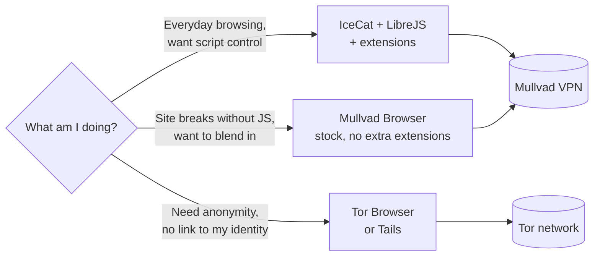

# Layer 3: Network Privacy

**Adversaries:** Internet service providers (ISPs), on-path network observers (for example on public Wi-Fi), traffic analysis, DNS snooping, ad-tech trackers, and browser fingerprinting.

**Goal:** my ISP learns as little as possible about what I do online, and websites cannot easily recognize me or follow me from one site to another.

If my traffic leaves the laptop unprotected and my DNS lookups go through my ISP, I am broadcasting a detailed log of my digital life. This layer handles two separate problems:

1. **Who can see my traffic** (the network path): VPN and Tor.
2. **Who can recognize my browser** (the endpoint): browser choice, compartmentalization, and extensions.

A VPN alone does not stop fingerprinting, and a hardened browser alone does not hide traffic from the ISP. They are complementary.

## Controls in this layer

| Control | What it does | Status |
| --- | --- | --- |
| [Mullvad VPN](./vpn.md) | Encrypts all traffic past my ISP; DAITA, Multihop, and DNS-level blocking | ✅ Implemented |
| [GNU IceCat + LibreJS](./icecat-librejs.md) | Daily browser with default-deny JavaScript | ✅ Implemented |
| [Mullvad Browser](./mullvad-browser.md) | Fingerprint-uniform browser for sites where IceCat is impractical | ✅ Implemented |
| [Tor Browser](./tor-browser.md) | Anonymity for high-risk, compartmentalized tasks only | ✅ Implemented (situational) |
| [Privacy extensions](./privacy-extensions.md) | Content blocking and anti-tracking inside IceCat | ✅ Implemented |

## Browser compartmentalization

Separating activities across browsers keeps cookies, logins, and fingerprints from bleeding between contexts.

## Residual risk for this layer

- **A VPN shifts trust rather than removing it.** Mullvad can see the same metadata my ISP used to see. I chose them on evidence, not blind faith (see [VPN](./vpn.md)).
- **My IceCat profile is fingerprintable.** Its extension set makes it relatively unique, and that trade-off is documented in [Privacy Extensions](./privacy-extensions.md#trade-offs).
- **Logging in links activity to me** no matter which browser or network I use.

---

[← Layer 2: Operating System](../02-Operating-System/README.md) · [Stack overview](../README.md) · [Layer 4: Identity & Credentials →](../04-Identity-Credentials/README.md)
