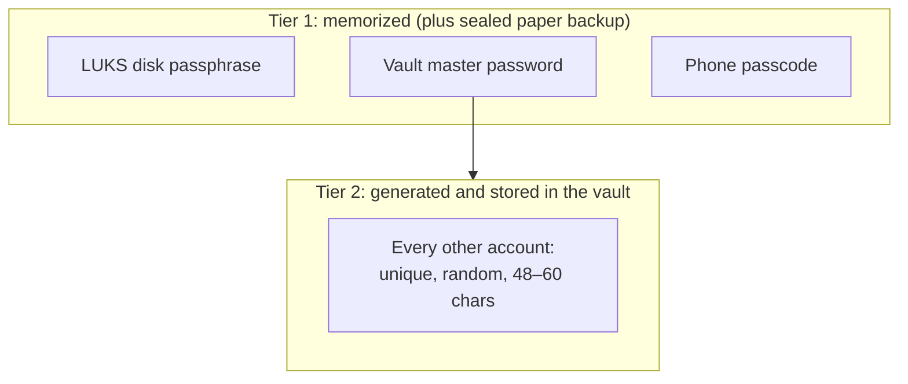

# Layer 4: Identity and Credentials

**Adversaries:** credential stuffing, phishing, keyloggers, SIM swapping, cloud password-manager breaches, and physical coercion.

**Goal:** no single stolen secret, breached server, or moment of coercion is enough to take over my accounts.

Online, your credentials **are** your identity. An attacker who gets a master password or gets past an account's MFA does not just steal data; they *become* you. They can drain accounts, hijack social media, and damage your reputation.

This layer is built on **identity sovereignty and zero trust:** I keep my password vault on hardware I control, I avoid SMS-based 2FA wherever an alternative exists, I do not use biometrics, and I do not store passwords with a cloud provider.

## Controls in this layer

| Control | What it does | Status |
| --- | --- | --- |
| [Self-hosted Vaultwarden vault](./password-manager.md) | Password vault on my own LAN-only server instead of a cloud provider | ✅ Implemented |
| [Passphrase strategy](./passphrase-strategy.md) | Tiered, high-entropy, unique credentials, and the math behind them | ✅ Implemented |
| [No-biometrics policy](./biometrics.md) | Passcodes instead of Face ID or fingerprints on every device | ✅ Implemented |
| [Mobile 2FA hardening](../06-Mobile-Security/mobile-2fa.md) | Moving remaining SMS 2FA to TOTP and hardware keys | 🧭 Planned (Layer 6) |

## How the credentials are tiered

## Residual risk for this layer

- **Some legacy financial institutions still force SMS 2FA,** which leaves those accounts exposed to SIM swapping until [SIM isolation](../06-Mobile-Security/sim-isolation.md) is in place.
- **Malware on an unlocked device** can capture a master password as it is typed. Strong passwords do not defend against keyloggers; the [OS layer](../02-Operating-System/README.md) does.
- **Vault backups are not yet off-device.** See [Vaultwarden](./password-manager.md#limitations-and-residual-risk).

---

[← Layer 3: Network Privacy](../03-Network-Privacy/README.md) · [Stack overview](../README.md) · [Layer 5: Financial Privacy →](../05-Financial-Privacy/README.md)
