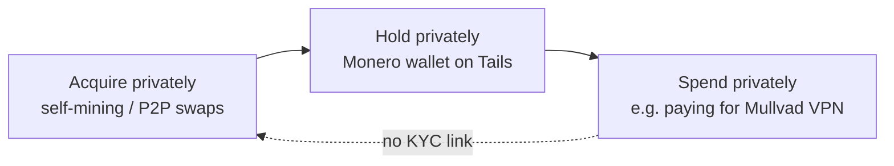

# Layer 5: Financial Privacy

**Adversaries:** centralized data breaches, financial surveillance and data brokers, blockchain analytics, and exchange failures (insolvency, freezes).

**Goal:** my financial activity is not a public, permanent, and linkable record, and my funds do not depend on a single custodian.

In traditional finance, your transaction history is held by third parties (banks, card processors, and in the worst case data brokers who monetize it), and each is a single point of failure. Centralized cryptocurrency exchanges are frequent targets for hackers and collect extensive KYC (Know Your Customer) identity data, which ties your identity to on-chain activity forever.

This layer documents how I use **cryptographic privacy** (Monero), an **isolated environment** for wallet keys (Tails), and **non-custodial acquisition** (self-mining and peer-to-peer swaps) to reduce those risks.

> **Disclaimer:** This section is provided strictly for educational and informational purposes about personal privacy, cryptography, and operational security. I do not condone or participate in tax evasion, money laundering, purchasing illicit goods, or any other illegal activity. Privacy is not a crime, and understanding how these systems work is essential for protecting yourself from breaches and surveillance. Everything in this section is done in compliance with applicable laws, including tax reporting. Nothing here is financial, tax, or legal advice; consult a licensed professional about your own situation.

## Controls in this layer

| Control | What it does | Status |
| --- | --- | --- |
| [Monero and cryptographic privacy](./crypto.md) | Hides sender, receiver, and amount by default; how stealth addresses, ring signatures, RingCT, and Dandelion++ work | ✅ Implemented |
| [Tails OS for wallet management](./tails-usb.md) | Wallet keys used only on an amnesic, Tor-only OS booted from USB | ✅ Implemented |
| [P2P exchanges and self-mining](./p2p-exchanges.md) | Acquiring XMR without KYC exchanges: mining with XMRig, non-custodial swaps | ✅ Implemented |

## The closed loop

## Residual risk for this layer

- **Regulatory and liquidity pressure.** Major exchanges have delisted Monero, and more restrictions are coming (see [Monero](./crypto.md#trade-offs)).
- **Behavior can undo cryptography.** Timing, amounts, and links to KYC'd accounts can de-anonymize even perfectly private transactions.
- **Tails is isolation, not cold storage.** See [Tails](./tails-usb.md#limitations-and-residual-risk).

---

[← Layer 4: Identity & Credentials](../04-Identity-Credentials/README.md) · [Stack overview](../README.md) · [Layer 6: Mobile Security →](../06-Mobile-Security/README.md)
