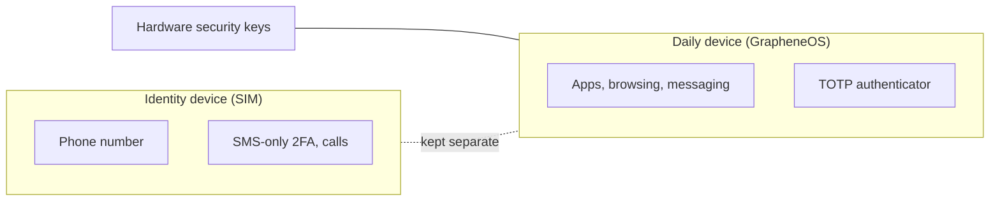

# Layer 6: Mobile Security (In Progress)

**Adversaries:** SIM swapping, cellular location tracking, malicious apps, and OS-level telemetry.

**Goal:** separate my real-world identity (phone number, banking) from my day-to-day digital life, and run my daily phone on an OS I can harden.

Phones are fundamentally different from laptops. They are always on, constantly connected to cell towers, and run operating systems (iOS and Android) that are deeply integrated with their vendors' cloud services. While my laptop is heavily locked down, my mobile setup has been **in transition since October 2026**. This layer documents the plan and will be filled in as each piece is implemented.

## Current state

| Area | Today |
| --- | --- |
| Device | iPhone |
| Unlock | Long alphanumeric passcode, Face ID disabled (see [No Biometrics](../04-Identity-Credentials/biometrics.md)) |
| Storage | Faraday bag when not in use (see [Faraday Bag](../01-Physical-Security/faraday-bag.md)) |
| 2FA | SMS-based 2FA still in use on some accounts; migration to TOTP and hardware keys planned |

## Roadmap

| Item | Plan | Status |
| --- | --- | --- |
| [GrapheneOS](./grapheneos.md) | Move my daily phone to a hardened, de-Googled Android OS | 🧭 Planned (choosing hardware) |
| [SIM isolation](./sim-isolation.md) | Move my phone number to a separate, locked-down device | 🧭 Planned |
| [Mobile 2FA hardening](./mobile-2fa.md) | Replace SMS 2FA with TOTP and hardware security keys wherever possible | 🧭 Planned |

## Target architecture

> Documentation for this layer will be completed as the hardware is acquired and each change is implemented. Until then, these pages describe the plan, the reasoning, and how I will verify each step. Nothing here is presented as already done.

---

[← Layer 5: Financial Privacy](../05-Financial-Privacy/README.md) · [Stack overview](../README.md)
