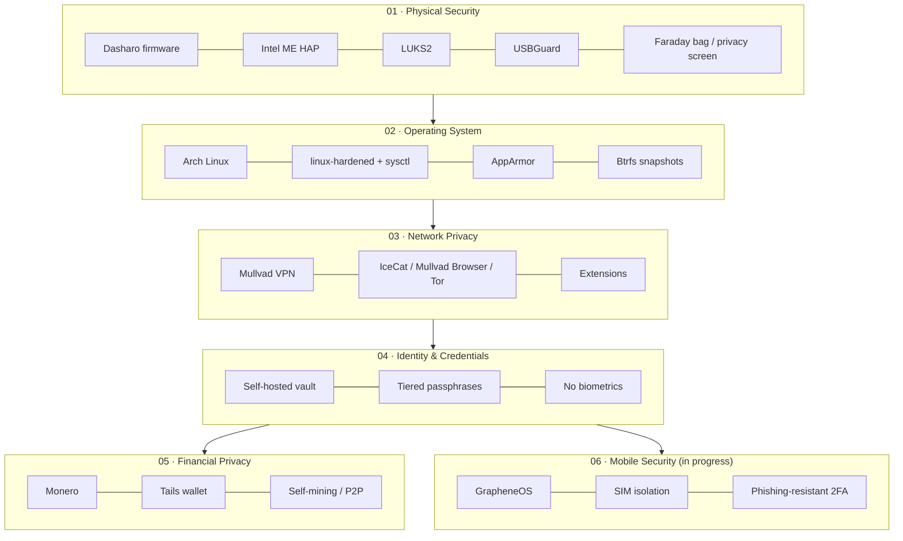

# My Personal Operational Security Stack

[](https://github.com/Stlwtrs/My-Personal-Operational-Security-Stack/actions/workflows/ci.yml)


A layered, threat-model-driven documentation of the security and privacy architecture I use every day, from firmware and disk encryption up through the network, my credentials, my finances, and my phone. Every control explains **what it defends against, how it works, how to verify it, and what it costs**, including where it falls short.

> I am a student going into cybersecurity. This repository is both my personal setup and a record of how I reason about security: threat model first, controls second, honest limitations always.

---

## Table of contents

- [What is operational security?](#what-is-operational-security)
- [Threat model](#threat-model)
- [Architecture](#architecture)
- [The stack at a glance](#the-stack-at-a-glance)
- [Design principles](#design-principles)
- [Verify it yourself](#verify-it-yourself)
- [Repository structure](#repository-structure)
- [How each document is organized](#how-each-document-is-organized)
- [What this project demonstrates](#what-this-project-demonstrates)
- [Roadmap](#roadmap)
- [Related project: AuricOS](#related-project-auricos)
- [Disclaimer](#disclaimer)
- [Authorship and AI disclosure](#authorship-and-ai-disclosure)
- [Closing notes](#closing-notes)

---

## What is operational security?

Operational security (OPSEC) is not just using a VPN or having a strong password. The term comes from the military: it is the process of identifying pieces of information that look harmless on their own but that an adversary could combine to compromise you, and then systematically eliminating those exposures.

In the digital world, OPSEC starts with **threat modeling**: recognizing that every action online (a DNS request, a browser fingerprint, a hardware identifier) leaves a trace. It is the practice of **shrinking the attack surface**, **compartmentalizing** data, and building **defense in depth**, so that if one layer fails, the rest still protect you.

## Threat model

Security is meaningless without knowing what you are defending against. My threat model is what I call **Tier 2**:

| In scope | Out of scope |
| --- | --- |
| ISPs and passive network observers | Nation-state actors targeting me specifically |
| Data brokers, ad-tech, and cross-site trackers | Hardware supply-chain interdiction |
| Opportunistic remote attackers (phishing, malvertising, credential stuffing, commodity malware) | TEMPEST and other electromagnetic side-channel attacks |
| Physical theft, lost devices, and brief unattended access | Advanced firmware or hardware implants |
| Shoulder surfers in public spaces | Global passive adversaries correlating Tor traffic |
| SIM swappers and account-takeover fraud | Sustained physical coercion |

The full model, with assets, assumptions, a threat-to-control matrix mapped to **MITRE ATT&CK**, and known residual risks, is in **[THREAT-MODEL.md](./THREAT-MODEL.md)**.

## Architecture



Each layer assumes the one beneath it could fail and adds independent protection, so no single failure exposes everything.

## The stack at a glance

| Layer | Control | Primary threat addressed | Status |
| --- | --- | --- | --- |
| **01 Physical** | [Hardware Selection](./01-Physical-Security/hardware-selection.md) | Closed firmware, camera/mic hijacking | ✅ |
| | [Intel ME (HAP)](./01-Physical-Security/intel-me-hap.md) | Management Engine attack surface | ✅ |
| | [LUKS2 Full Disk Encryption](./01-Physical-Security/luks-encryption.md) | Data theft from a lost or stolen laptop | ✅ |
| | [USBGuard](./01-Physical-Security/usbguard.md) | BadUSB / malicious USB devices | ✅ |
| | [Faraday Bag](./01-Physical-Security/faraday-bag.md) | RF tracking of stored devices | ✅ |
| | [Privacy Screen](./01-Physical-Security/privacy-screen.md) | Shoulder surfing | ✅ |
| **02 Operating System** | [Arch Linux](./02-Operating-System/arch-linux.md) | Unnecessary attack surface | ✅ |
| | [`linux-hardened`](./02-Operating-System/linux-hardened.md) | Kernel exploitation | ✅ |
| | [AppArmor (MAC)](./02-Operating-System/apparmor-selinux.md) | Post-exploitation file access | ✅ |
| | [Sysctl Hardening](./02-Operating-System/sysctl-hardening.md) | Kernel info leaks, ptrace injection | ✅ |
| | [Btrfs Snapshots](./02-Operating-System/btrfs-snapshots.md) | Bad updates, user error | ✅ |
| **03 Network** | [Mullvad VPN](./03-Network-Privacy/vpn.md) | ISP surveillance, traffic analysis | ✅ |
| | [GNU IceCat + LibreJS](./03-Network-Privacy/icecat-librejs.md) | Untrusted JavaScript | ✅ |
| | [Mullvad Browser](./03-Network-Privacy/mullvad-browser.md) | Browser fingerprinting | ✅ |
| | [Tor Browser](./03-Network-Privacy/tor-browser.md) | Single-provider trust, IP identification | ✅ |
| | [Privacy Extensions](./03-Network-Privacy/privacy-extensions.md) | Trackers, malvertising, port scans | ✅ |
| **04 Identity** | [Self-hosted Vaultwarden](./04-Identity-Credentials/password-manager.md) | Cloud password-manager breaches | ✅ |
| | [Passphrase Strategy](./04-Identity-Credentials/passphrase-strategy.md) | Brute force, credential stuffing | ✅ |
| | [No Biometrics](./04-Identity-Credentials/biometrics.md) | Coerced unlocking | ✅ |
| **05 Financial** | [Monero](./05-Financial-Privacy/crypto.md) | Blockchain analysis | ✅ |
| | [Tails for wallets](./05-Financial-Privacy/tails-usb.md) | Key theft by daily-OS malware | ✅ |
| | [P2P and self-mining](./05-Financial-Privacy/p2p-exchanges.md) | KYC breaches, exchange freezes | ✅ |
| **06 Mobile** | [GrapheneOS](./06-Mobile-Security/grapheneos.md) | Malicious apps, OS telemetry | 🧭 Planned |
| | [SIM Isolation](./06-Mobile-Security/sim-isolation.md) | SIM swapping | 🧭 Planned |
| | [Mobile 2FA](./06-Mobile-Security/mobile-2fa.md) | MFA interception and phishing | 🧭 Planned |

**Legend:** ✅ implemented · 🧭 planned (documented as a plan, not presented as done)

## Design principles

1. **Threat model first.** Every tool is here because it addresses a specific, realistic threat in my model. No friction for its own sake.
2. **Defense in depth.** Each layer assumes the layer below it might fail.
3. **Minimize attack surface.** The most secure component is the one that is not installed.
4. **Compartmentalize.** Separate browsers, a separate OS for money, and (soon) a separate device for my phone number, so one compromise does not cascade.
5. **Usable security.** The more private you get, the less convenient things become. That trade-off is unavoidable, so I make it deliberately and document it.
6. **Verify, don't trust.** Every control comes with commands to confirm that it is actually working.
7. **Be honest about limits.** Every document includes a *Limitations and residual risk* section. A control you overestimate is more dangerous than one you understand.

## Verify it yourself

[`scripts/verify-stack.sh`](./scripts/verify-stack.sh) is a **read-only** audit script that checks the OS and physical-layer controls on a running Linux system and reports `PASS` / `WARN` / `FAIL` for each:

```bash
./scripts/verify-stack.sh          # unprivileged checks
sudo ./scripts/verify-stack.sh     # adds checks that need root (LUKS header, AppArmor modes, USBGuard rules)
```

It checks the hardened kernel, sysctl values, AppArmor status, LUKS2 cipher and KDF, Btrfs and Snapper, USBGuard policy and permissions, Intel MEI visibility, and the Mullvad connection. It changes nothing on the system. Reference configs live in [`configs/`](./configs/).

## Repository structure

```text
.
├── README.md                  ← you are here
├── THREAT-MODEL.md            ← assets, adversaries, ATT&CK-mapped control matrix, residual risk
├── GLOSSARY.md                ← terms used throughout the docs
├── CHANGELOG.md
├── 01-Physical-Security/      ← firmware, Intel ME, LUKS, USBGuard, Faraday bag, privacy screen
├── 02-Operating-System/       ← Arch, linux-hardened, AppArmor, sysctl, Btrfs snapshots
├── 03-Network-Privacy/        ← Mullvad VPN, IceCat, Mullvad Browser, Tor, extensions
├── 04-Identity-Credentials/   ← Vaultwarden, passphrase strategy, no-biometrics policy
├── 05-Financial-Privacy/      ← Monero, Tails, self-mining and P2P swaps
├── 06-Mobile-Security/        ← GrapheneOS, SIM isolation, mobile 2FA (planned)
├── configs/                   ← sanitized reference configurations
├── scripts/                   ← verify-stack.sh audit script, docs link checker
└── .github/workflows/         ← CI: ShellCheck, Markdown lint, link and JSON validation
```

## How each document is organized

Every control page follows the same structure, so they are easy to scan and compare:

| Section | Purpose |
| --- | --- |
| **Header table** | Layer, status, threats mitigated, MITRE ATT&CK techniques, last reviewed date |
| **Why this control exists** | The threat, in plain language |
| **How it works** | The underlying mechanism |
| **My implementation** | What I actually run and how it is configured |
| **Verification** | Commands or tests that prove it is working |
| **Trade-offs** | What it costs in convenience, performance, or money |
| **Limitations and residual risk** | What it does *not* protect against |
| **Verdict** | Whether it is worth it, for my threat model |
| **References** | Primary sources |

## What this project demonstrates

- **Threat modeling:** scoping adversaries, assets, and assumptions before choosing tools.
- **Linux system hardening:** kernel selection, sysctl tuning, mandatory access control, USB device policy, full-disk encryption, and recovery design.
- **Firmware awareness:** open-source firmware (coreboot/Dasharo) and Intel ME mitigation.
- **Network privacy engineering:** VPN trust trade-offs, traffic-analysis defenses, Tor, and browser fingerprinting strategies.
- **Applied cryptography fundamentals:** key derivation, entropy math, AES-XTS, and Monero's stealth addresses, ring signatures, and Pedersen commitments.
- **Framework mapping:** controls mapped to MITRE ATT&CK techniques.
- **Security automation:** a read-only audit script and CI that lints and validates the repository.
- **Technical writing:** consistent, verifiable documentation that is honest about limitations.

## Roadmap

- [ ] **Mobile:** move to GrapheneOS (waiting on the Motorola partnership device, with a Pixel as fallback)
- [ ] **Mobile:** isolate my phone number on a separate device
- [ ] **Identity:** replace remaining SMS 2FA with FIDO2 security keys and TOTP
- [ ] **Backups:** add an offline / air-gapped NAS so snapshots and the vault have a true off-device backup
- [ ] **Docs:** keep every page reviewed as tools and my threat model evolve

## Related project: AuricOS

**[AuricOS](https://github.com/Stlwtrs/AuricOS-v1.0)** is my custom Arch-based live operating system, built with `archiso`. Many of the hardening ideas documented here are things I am building into it.

## Disclaimer

This repository documents my personal setup for **educational and informational purposes**. It is not legal, financial, or tax advice. Nothing here condones illegal activity. Privacy tools are used by journalists, activists, and ordinary people every day, and they should be used responsibly and lawfully. Your threat model is not my threat model: adapt, do not copy.

## Authorship and AI disclosure

The setup, choices, and original writing in this repository are my own. For the v2.0 revision, I used **Claude (Anthropic)** as an editor and technical reviewer: it helped restructure the documents into a consistent format, fact-check technical claims against primary sources, correct inaccuracies, add verification steps and ATT&CK mappings, and write the audit script and CI. I reviewed the changes. I am disclosing this to be transparent about how the project was made.

## Closing notes

I will keep updating this stack as my threat model and methodology evolve. I am a student going into the cybersecurity field and still learning, so things will change as my schooling goes on. Corrections and suggestions are welcome; feel free to open an issue.

Thanks for being here, and enjoy the guide.
